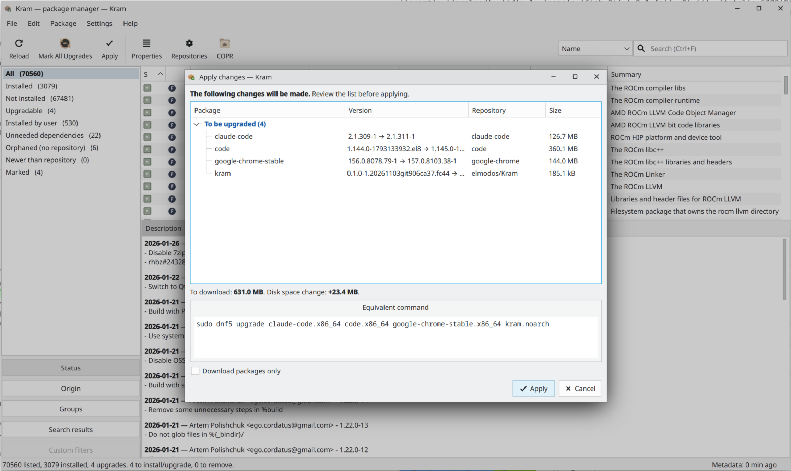
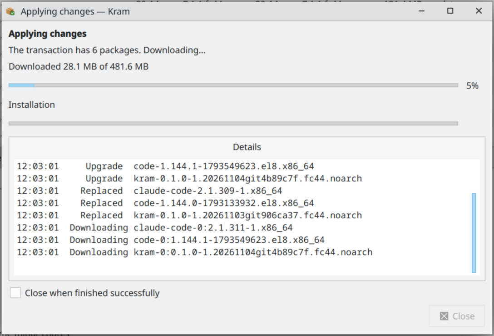
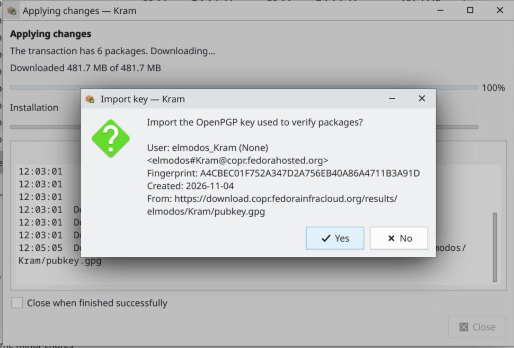
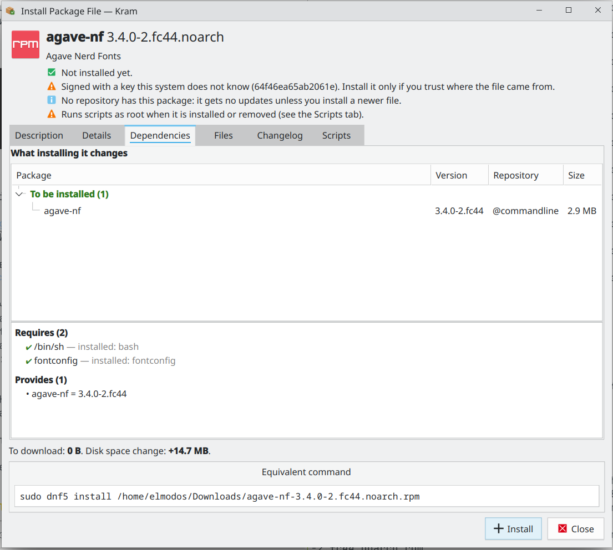
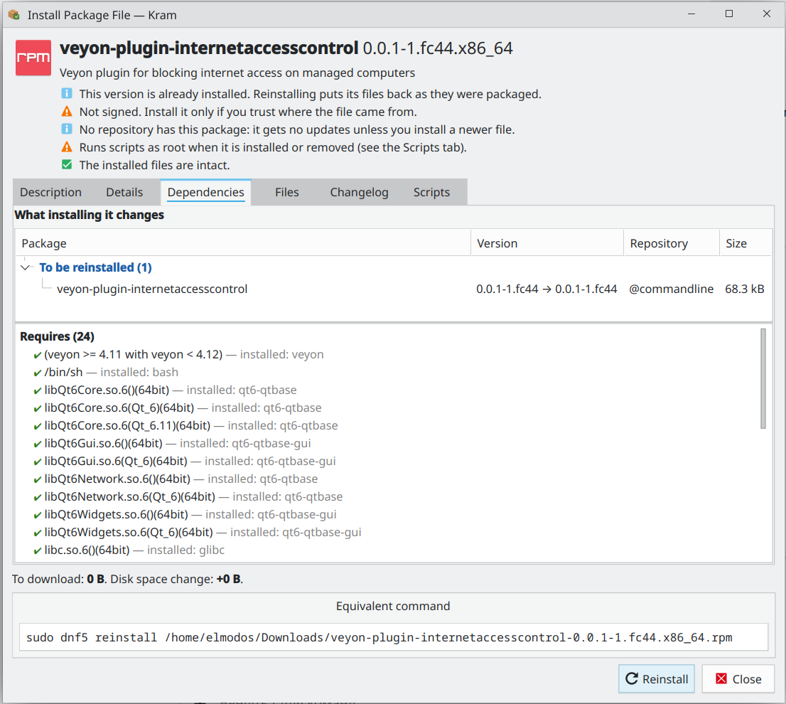
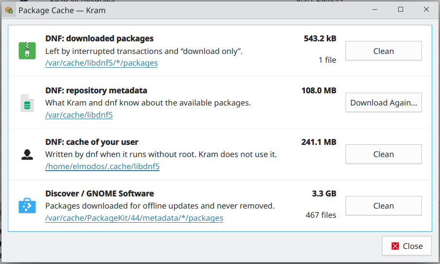
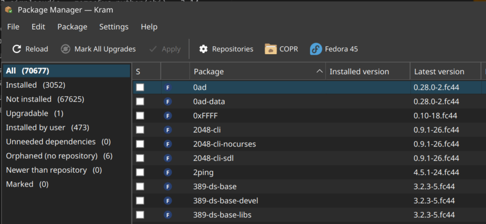
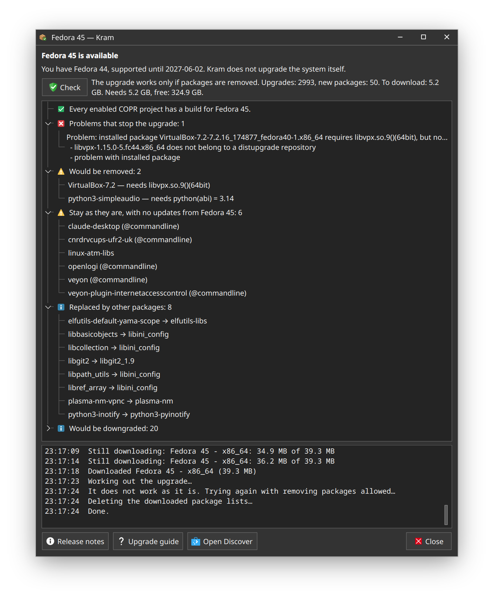
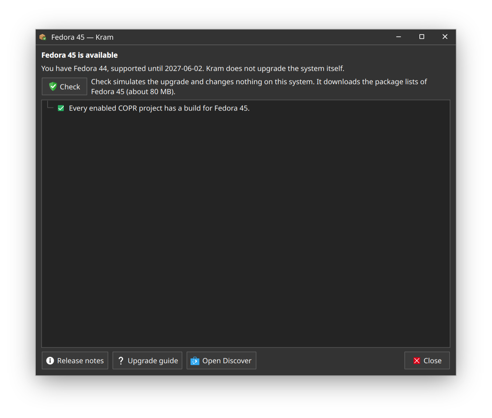
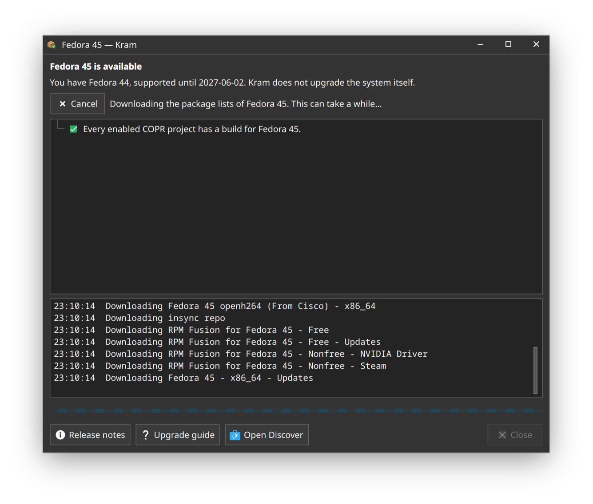

# Kram

[](https://copr.fedorainfracloud.org/coprs/elmodos/Kram/package/kram/)
[](https://copr.fedorainfracloud.org/coprs/elmodos/Kram/)
[](https://copr.fedorainfracloud.org/coprs/elmodos/Kram/)
[](https://github.com/elmodos/kram/tags)
[](LICENSE)
[](#translations)

A Synaptic-style package manager for Fedora: the full package list, checkboxes, statuses and origins,
search that works, and nothing happens until you press **Apply**.

Built on libdnf5 (the same library as `dnf5`) and Qt 6. See [docs/PLAN.md](docs/PLAN.md) for the design.


| Review before applying | COPR projects |
|---|---|
|  |  |

| Progress | Key import |
|---|---|
|  |  |

| Installing a downloaded .rpm | What satisfies each dependency |
|---|---|
|  |  |

| What the package caches take |
|---|
|  |

| A new Fedora release on the toolbar | What moving to it would do |
|---|---|
|  |  |

| Before the check | While it runs |
|---|---|
|  |  |

## Features

- Every package of the enabled repositories in one table: status, origin (Fedora / COPR / third-party /
  local), installed and latest version, repository, size.
- Filters by status, origin and repository, comps group, and earlier searches; your own custom filters
  (name, summary, description, provided capability, status, origin, repository, group, install reason,
  architecture, size),
  e.g. "installed by user from COPR" or "unneeded dependencies over 50 MB" or, with `application()`, only what has a menu entry.
- Search ranked by relevance: by name, name and summary, description, provided capability or file.
- Mark for installation, upgrade, reinstallation, downgrade to a chosen version, removal, or change the
  install reason; review the whole transaction (with dependencies and the equivalent `dnf5` command) before
  anything happens. Markings can be saved to a file and read back (File menu).
- Choose which recommended packages to install: a checkbox per recommendation, with the size each one adds.
- Install a downloaded `.rpm` file (File → Open Package File…, drop it on the window, or "Open with Kram" in
  the file manager). Before anything happens it shows whether this installs, upgrades, downgrades or
  reinstalls, who signed the file, the scripts it runs as root, what satisfies each dependency and whether a
  repository has a newer version. A reinstall first checks the installed files (`rpm -V`). The helper installs exactly the file you
  saw (checked by its SHA-256), read with your own permissions.
- Description, dependencies (clickable), files, all versions and the changelog of every package.
- Enable and disable repositories; enable, disable and remove COPR projects, search Copr.
- See what the package caches take and where they are, and clean them, including the packages Discover and
  GNOME Software downloaded and left behind (Settings → Package Cache).
- Tells you when a new Fedora release is out (a toolbar button, checked on Reload against Fedora's Bodhi) and works
  out what moving to it would do: what blocks it, what would be removed, COPR projects without a build, the disk
  space. It only reports: the upgrade itself stays with Discover or GNOME Software.
- An optional icon in the system tray while updates are available, showing how many and how many of them are
  security updates (Settings → Update Notifications, off by default). It downloads nothing: Fedora's own
  `dnf-makecache.timer` refreshes the package information, a small check reads it at login, hourly and after
  every installation, and the icon process exists only while there are updates. Clicking it opens Kram on the
  upgradable packages. Needs a tray that shows StatusNotifierItem icons (Plasma, Xfce, LXQt, GNOME with the
  AppIndicator extension).
- One password per session (polkit); browsing and searching need none.
- In 13 languages ([Translations](#translations)).

## Installing

From COPR (builds of `main`):

```sh
sudo dnf copr enable elmodos/Kram
sudo dnf install kram
```

Or build and install the RPM from a checkout (the same steps COPR runs):

```sh
sudo dnf install rpm-build make git-core 'dnf5-command(builddep)'
make -f .copr/Makefile srpm outdir=/tmp/kram
sudo dnf builddep /tmp/kram/kram-*.src.rpm
rpmbuild --rebuild /tmp/kram/kram-*.src.rpm
sudo dnf install ~/rpmbuild/RPMS/noarch/kram-*.noarch.rpm
```

The package installs the root helper as `/usr/libexec/kram-helper` with its own polkit action
(`io.github.elmodos.Kram.helper`), the `.desktop` file, AppStream metadata and the translations.

## Running from a checkout

Tested on Fedora 44 with KDE Plasma; any Qt-friendly desktop should work:

```sh
sudo dnf install python3-libdnf5 python3-rpm python3-pyside6 polkit gettext
python3 -m kram
python3 -m kram ~/Downloads/some-package.rpm   # only the installer for that file
```

Browsing and searching need no privileges. Applying changes or refreshing metadata asks for the
administrator password once per session (through `pkexec`).

## Development

```sh
python3 -m pytest          # unit tests (needs pytest; gettext for the translation tests)
ruff check .
scripts/container_check.sh # real root transactions in a throwaway Fedora container (podman)
scripts/rpm_check.sh       # build the RPM like COPR does, install it and check it, in a container
```

- `kram/core/` has no Qt and is where most logic and tests live.
- `kram/helper/kram_helper.py` is the only code that runs as root. Keep it small; it is the security
  boundary.
- All libdnf5 calls in the GUI process happen on one worker thread (`kram/ui/dnf_thread.py`).

### Packaging and COPR

- `packaging/kram.spec` is the RPM spec; `data/` has the `.desktop` file, AppStream metainfo, polkit policy
  and icon, all named after the app id `io.github.elmodos.Kram` (`kram/__init__.py`).
- How the COPR project builds and how a release is made: [docs/COPR.md](docs/COPR.md).
- `.copr/Makefile` builds an SRPM from the current commit: a plain release for the commit tagged
  `v<version>`, a `<version>^YYYYMMDDHHMMSSgitHASH` snapshot for any other commit.
- A release: bump the version (see [docs/COPR.md](docs/COPR.md#releases)), tag `v<version>`, push the tag and
  point the COPR package's Committish at it.

## Translations

Kram follows the desktop's language setting.

| Language | | Code | Status |
|---|---|---|---|
| Čeština | Czech | `cs` | needs review |
| Deutsch | German | `de` | needs review |
| English | English | — | source |
| Español | Spanish | `es` | needs review |
| Français | French | `fr` | needs review |
| Italiano | Italian | `it` | needs review |
| 日本語 | Japanese | `ja` | needs review |
| 한국어 | Korean | `ko` | needs review |
| Polski | Polish | `pl` | needs review |
| Português (Brasil) | Portuguese (Brazil) | `pt_BR` | needs review |
| Svenska | Swedish | `sv` | needs review |
| Українська | Ukrainian | `uk` | reviewed |
| 简体中文 | Chinese (Simplified) | `zh_CN` | needs review |

"Needs review" means a complete first pass not yet checked by a native speaker. If something reads oddly in
your language, please fix it in `po/<code>.po` and open a pull request, or just open an issue quoting the
string and a better wording. New languages are welcome too.

For developers: user-visible strings are English in the code and translated with gettext:

```python
from kram.i18n import _, ngettext, pgettext, N_

_("Reload")
ngettext("{n} package", "{n} packages", n).format(n=n)   # plurals
pgettext("package status", "Installed")                   # same English word, different translations
```

Use named `{placeholders}` with `.format()`, never f-strings inside `_()`.

- Update the template and all catalogs after changing strings: `scripts/i18n.sh update`
- Start a new language: `scripts/i18n.sh new <lang>` (e.g. `nl`, `zh_TW`), then translate `po/<lang>.po`;
  also add the language to `data/` (`GenericName`/`Comment`/`Keywords` in both `.desktop` files, the metainfo `summary`
  and the polkit `description`/`message`)
- Validate: `scripts/i18n.sh check` (the test suite also checks that the template is current, catalogs
  are complete, and placeholders match)

To try a language without changing the desktop: `LANGUAGE=de python3 -m kram`.

## License

Kram is released under the [MIT License](LICENSE).

SPDX-License-Identifier: MIT
