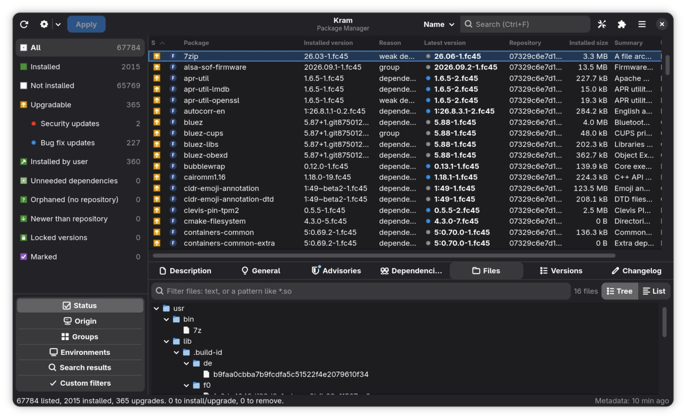
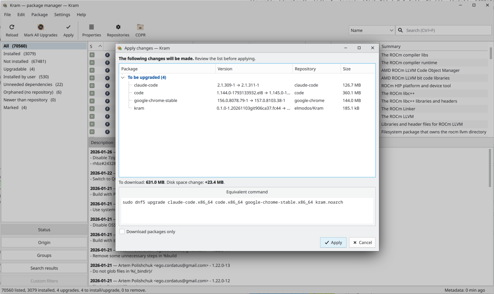
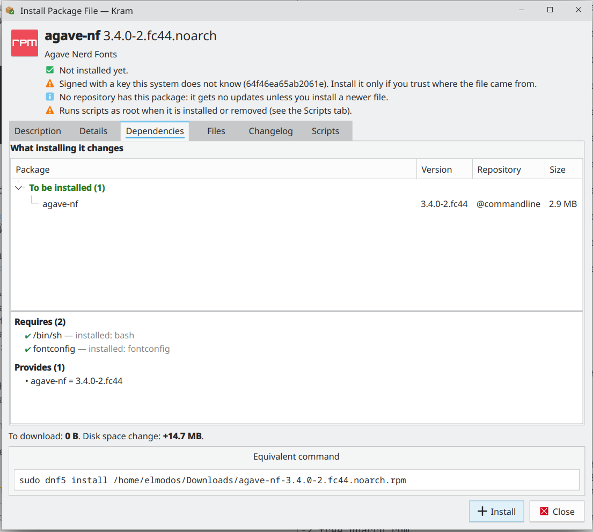
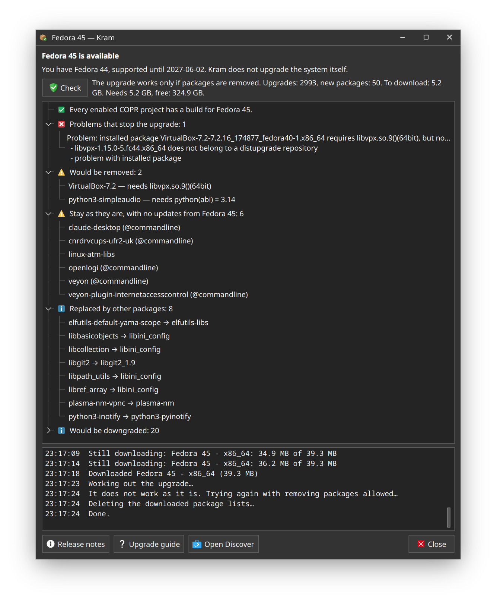

# Kram

[](https://copr.fedorainfracloud.org/coprs/elmodos/Kram/package/kram/)
[](https://copr.fedorainfracloud.org/coprs/elmodos/Kram/)
[](https://copr.fedorainfracloud.org/coprs/elmodos/Kram/)
[](https://github.com/elmodos/kram/tags)
[](LICENSE)
[](docs/TRANSLATING.md)

A Synaptic-style package manager for Fedora: the full package list, checkboxes, statuses and origins,
search that works, and nothing happens until you press **Apply**.

Built on libdnf5 (the same library as `dnf5`), with two front ends to choose from: Qt 6 for KDE Plasma and other
Qt desktops, GTK 4 and libadwaita for GNOME.


*The Qt front end (KDE, Xfce and other desktops).*


*The GTK 4 front end (GNOME).*

| Review before applying | Check a downloaded .rpm | Ready for the next Fedora? |
|---|---|---|
| [](docs/guide/applying-changes.md) | [](docs/guide/rpm-files.md) | [](docs/guide/fedora-release.md) |

## Features

- **Every package in one table**, installed or not: status, origin (Fedora, COPR, third-party, local),
  versions, repository, size. [The package list](docs/guide/package-list.md)
- **Filters and search**: by status, origin, repository, group and environment, your own custom filters ("unneeded
  dependencies over 50 MB"), search ranked by relevance. [Filters](docs/guide/package-list.md#filters)
- **Mark first, apply later**: install, upgrade, reinstall, downgrade to a chosen version, remove, remove
  unneeded dependencies as `dnf autoremove`; choose
  which recommended packages to take; review the whole transaction and the equivalent `dnf5` command.
  [Marking and applying](docs/guide/applying-changes.md)
- **Transaction history**: what dnf installed, upgraded and removed, and when; undo a transaction by marking the
  changes that take it back. [Transaction history](docs/guide/history.md)
- **Version lock**: keep a package at its installed version, and see which upgrade the lock holds back.
  [Locking a version](docs/guide/package-list.md#locking-a-version)
- **Downloaded .rpm files**, checked before installing: signature, root scripts, dependencies, a newer
  version in a repository. [Installing a file](docs/guide/rpm-files.md)
- **Repositories and COPR**: enable, disable and remove them, search Copr. [Repositories and
  COPR](docs/guide/repositories.md)
- **A new Fedora release**: what blocks the upgrade, what it would remove, the disk space it needs.
  [Fedora release](docs/guide/fedora-release.md)
- **Cleanup**: what the caches take, including what Discover and GNOME Software left behind, and
  cleaning them; rpm's leftover `.rpmnew`/`.rpmsave` files, compared and deleted. [Cleanup](docs/guide/package-cache.md)
- **Tray icon while updates are available** (optional, off by default), without any background downloads.
  [Update notifications](docs/guide/update-notifications.md)
- **One password per session** (polkit); browsing and searching need none.
- **In 13 languages**. [Translations](docs/TRANSLATING.md)
- **On GNOME**, a GTK 4 and libadwaita window (`kram-gtk`). The Qt one also fits in there: light or dark as the
  desktop is, switching along with it, in libadwaita's colours; a Qt look you chose yourself (`QT_STYLE_OVERRIDE`,
  or a platform theme such as qt6ct) is left as it is.

## User guide

What each part of Kram does, with screenshots:

- [The package list](docs/guide/package-list.md): the table, the sidebar filters, search and the package
  details.
- [Marking and applying changes](docs/guide/applying-changes.md): marking packages, reviewing the
  transaction, the progress window and key import.
- [Transaction history](docs/guide/history.md): past transactions, their packages, and undoing one.
- [Installing a downloaded .rpm file](docs/guide/rpm-files.md): what Kram checks before installing a file.
- [Repositories and COPR](docs/guide/repositories.md): enabling repositories and COPR projects, searching
  Copr.
- [A new Fedora release](docs/guide/fedora-release.md): what moving to the next release would do.
- [Cleanup](docs/guide/package-cache.md): what the caches take and how to clean them; leftover configuration files.
- [Update notifications](docs/guide/update-notifications.md): the optional tray icon.

## Installing

From COPR, with the Qt front end (`kram-qt`), for KDE Plasma and other Qt desktops:

```sh
sudo dnf copr enable elmodos/Kram
sudo dnf install kram
```

Or with the GTK 4 and libadwaita front end, for GNOME:

```sh
sudo dnf copr enable elmodos/Kram
sudo dnf install kram-gtk
```

Both are the same program and start with `kram`; only one of them can be installed at a time. To change from one
to the other (settings, saved markings and the tray icon stay as they are):

```sh
sudo dnf swap kram-qt kram-gtk   # Qt → GTK
sudo dnf swap kram-gtk kram-qt   # GTK → Qt
```

Kram 0.11 and older was a single `kram` package; `dnf upgrade` replaces it with `kram-qt`. To go from it straight
to GTK: `sudo dnf swap kram kram-gtk`.

To build the RPM yourself, or to run Kram from a checkout, see
[CONTRIBUTING.md](CONTRIBUTING.md).

## Contributing

Issues and pull requests are welcome: [CONTRIBUTING.md](CONTRIBUTING.md) for code,
[docs/TRANSLATING.md](docs/TRANSLATING.md) for translations, [docs/PLAN.md](docs/PLAN.md) for the design.

## License

Kram is released under the [MIT License](LICENSE).

SPDX-License-Identifier: MIT
