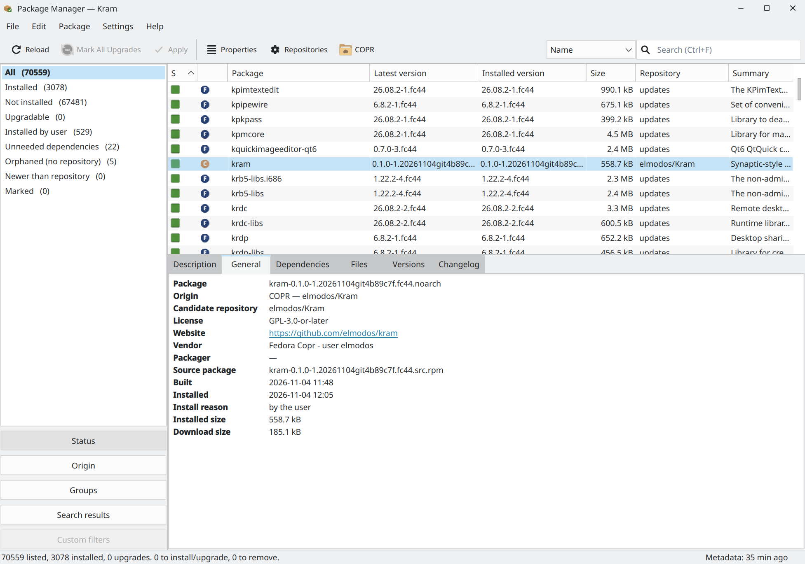
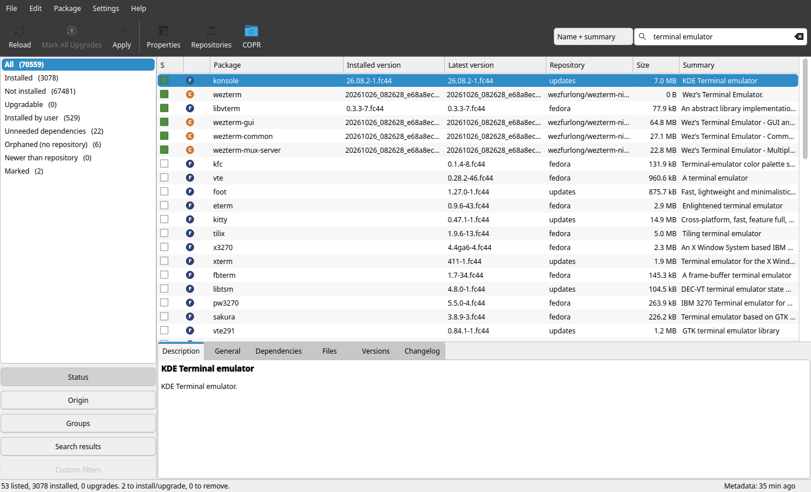
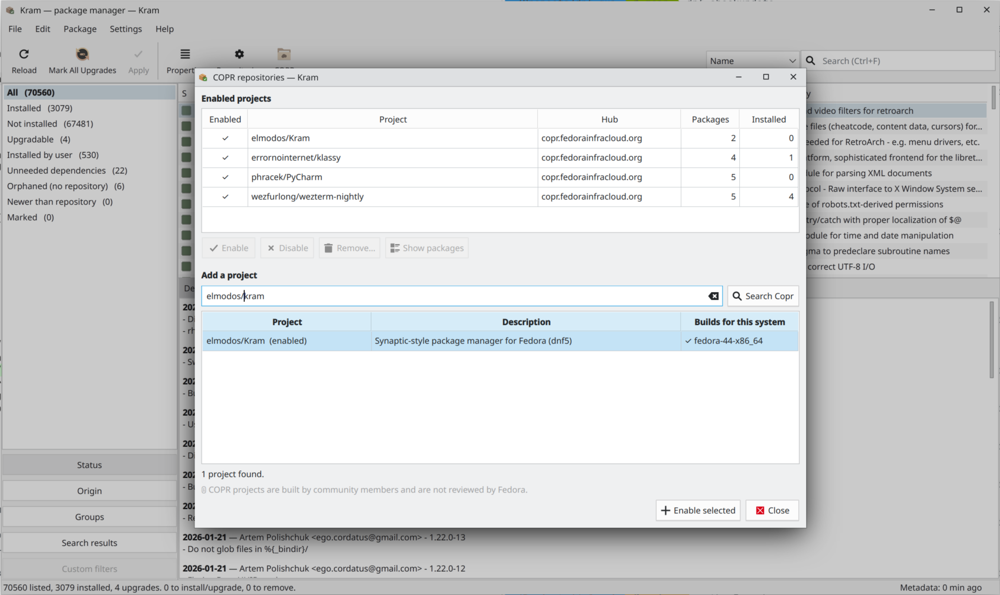

# Kram

A Synaptic-style package manager for Fedora: the full package list, checkboxes, statuses and origins,
search that works, and nothing happens until you press **Apply**.

Built on libdnf5 (the same library as `dnf5`) and Qt 6. See [docs/PLAN.md](docs/PLAN.md) for the design.



| Ranked search | COPR projects |
|---|---|
|  |  |

## Features

- Every package of the enabled repositories in one table: status, origin (Fedora / COPR / third-party /
  local), installed and latest version, repository, size.
- Filters by status, origin and repository, comps group, and earlier searches.
- Search ranked by relevance: by name, name and summary, description, provided capability or file.
- Mark for installation, upgrade, reinstallation, downgrade to a chosen version, removal, or change the
  install reason; review the whole transaction (with dependencies and the equivalent `dnf5` command) before
  anything happens. Markings can be saved to a file and read back (File menu).
- Description, dependencies (clickable), files, all versions and the changelog of every package.
- Enable and disable repositories; enable, disable and remove COPR projects, search Copr.
- One password per session (polkit); browsing and searching need none.

## Installing

Build and install the RPM from a checkout (the same steps COPR runs):

```sh
sudo dnf install rpm-build make git-core 'dnf5-command(builddep)'
make -f .copr/Makefile srpm outdir=/tmp/kram
sudo dnf builddep /tmp/kram/kram-*.src.rpm
rpmbuild --rebuild /tmp/kram/kram-*.src.rpm
sudo dnf install ~/rpmbuild/RPMS/noarch/kram-*.noarch.rpm
```

The package installs the root helper as `/usr/libexec/kram-helper` with its own polkit action
(`io.github.elmodos.Kram.helper`), the `.desktop` file, AppStream metadata and the translations.

## Running from a checkout

Tested on Fedora 44 with KDE Plasma; any Qt-friendly desktop should work:

```sh
sudo dnf install python3-libdnf5 python3-rpm python3-pyside6 polkit gettext
python3 -m kram
```

Browsing and searching need no privileges. Applying changes or refreshing metadata asks for the
administrator password once per session (through `pkexec`).

## Development

```sh
python3 -m pytest          # unit tests (needs pytest; gettext for the translation tests)
ruff check .
scripts/container_check.sh # real root transactions in a throwaway Fedora container (podman)
scripts/rpm_check.sh       # build the RPM like COPR does, install it and check it, in a container
QT_QPA_PLATFORM=offscreen LANGUAGE=en python3 scripts/screenshots.py docs/screenshots  # README images
```

- `kram/core/` has no Qt and is where most logic and tests live.
- `kram/helper/kram_helper.py` is the only code that runs as root. Keep it small; it is the security
  boundary.
- All libdnf5 calls in the GUI process happen on one worker thread (`kram/ui/dnf_thread.py`).

### Packaging and COPR

- `packaging/kram.spec` is the RPM spec; `data/` has the `.desktop` file, AppStream metainfo, polkit policy
  and icon, all named after the app id `io.github.elmodos.Kram` (`kram/__init__.py`).
- Step-by-step COPR setup: [docs/COPR.md](docs/COPR.md).
- `.copr/Makefile` builds an SRPM from the current commit with a `.YYYYMMDDgitHASH` release suffix. To
  build in COPR: create a project, add a package with source type *SCM*, the clone URL of this repository,
  build method *make srpm*, and optionally enable *Auto-rebuild* with the GitHub webhook.
- A release: bump the version in `pyproject.toml`, `kram/__init__.py` and `packaging/kram.spec` (with a
  `%changelog` entry and a `<release>` in the metainfo), then tag `v<version>`.

## Translations

User-visible strings are English in the code and translated with gettext:

```python
from kram.i18n import _, ngettext, pgettext, N_

_("Reload")
ngettext("{n} package", "{n} packages", n).format(n=n)   # plurals
pgettext("package status", "Installed")                   # same English word, different translations
```

Use named `{placeholders}` with `.format()`, never f-strings inside `_()`.

- Update the template and all catalogs after changing strings: `scripts/i18n.sh update`
- Start a new language: `scripts/i18n.sh new de`, then translate `po/de.po`
- Validate: `scripts/i18n.sh check` (the test suite also checks that the template is current, catalogs
  are complete, and placeholders match)

The language follows the environment, e.g. `LANGUAGE=uk python3 -m kram`.

## License

Kram is free software: you can redistribute it and/or modify it under the terms of the GNU General Public
License as published by the Free Software Foundation, either version 3 of the License, or (at your option)
any later version. See [LICENSE](LICENSE).

SPDX-License-Identifier: GPL-3.0-or-later
