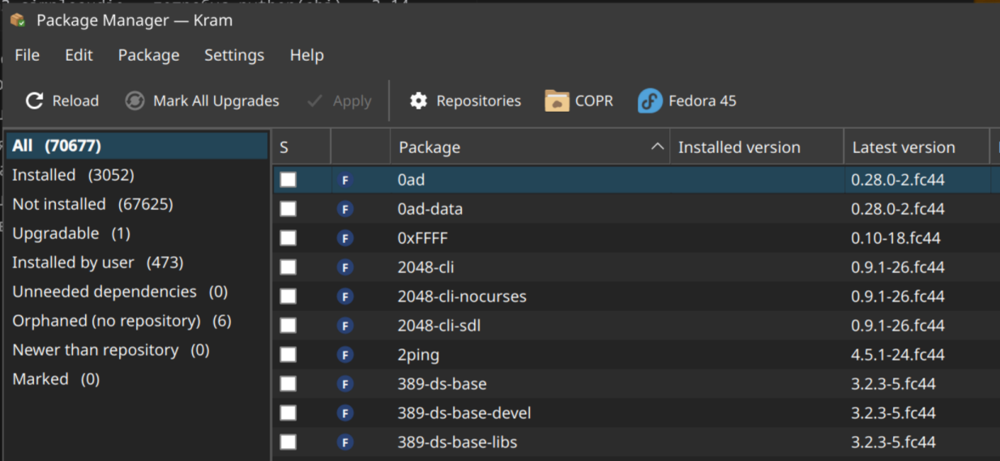
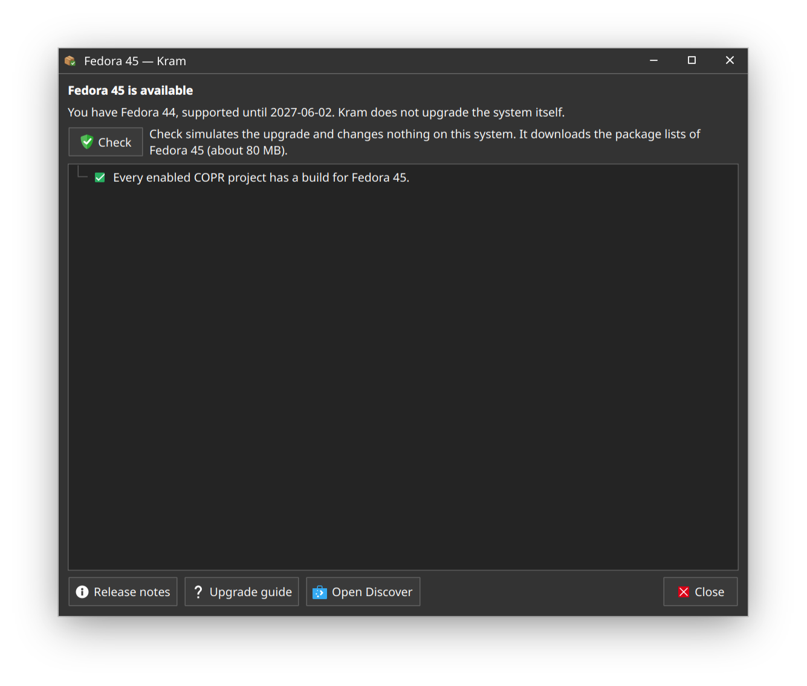
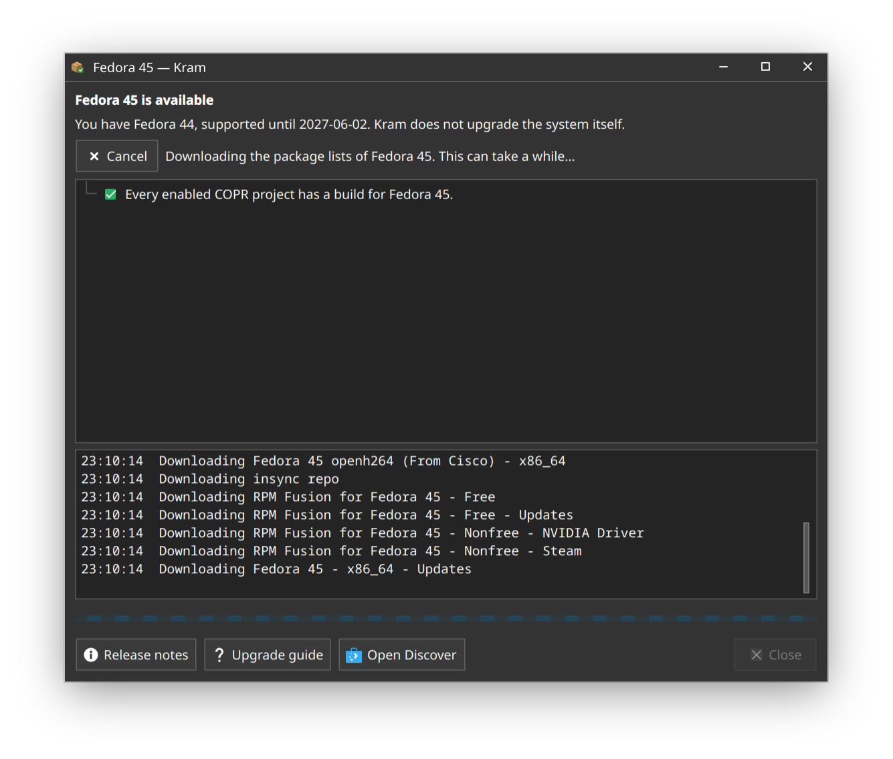

# A new Fedora release

When a new Fedora release is out, a button for it appears on the toolbar. Kram checks for one on Reload, against
Fedora's Bodhi. Settings → *Watch Fedora Releases* turns this off.

*Fedora 45 is out: the button opens the window below.*

The window works out what moving to the new release would do to this system. It only reports: Kram does not
upgrade the system itself, that stays with Discover or GNOME Software. The buttons
at the bottom open the release notes, Fedora's upgrade guide and Discover.

| Before the check | While it runs |
|---|---|
|  |  |
| *COPR projects are checked right away. **Check** simulates the upgrade and changes nothing.* | *It downloads the package lists of the new release (about 80 MB) and deletes them when done.* |

*The result: what stops the upgrade and why, what would be removed, what would stay behind with no updates,
what is replaced or downgraded, and the download and disk space it needs.*

Next: [Package cache](package-cache.md).
