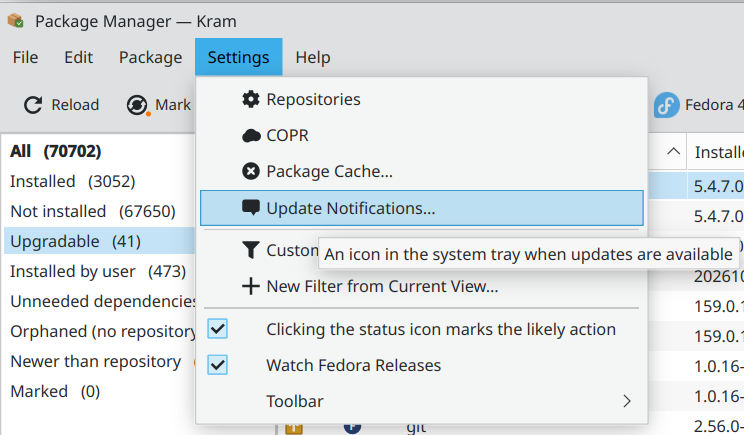

# Update notifications

Kram can show an icon in the system tray while updates are available, with how many there are and how many
of them are security updates. Clicking it opens Kram on the upgradable packages. It is off by default.

*Turn it on in Settings → Update Notifications…*

*The settings, with the state of Fedora's own update check and of other update notifiers on the system.*

How it works:

- Kram downloads nothing in the background. Fedora's own `dnf-makecache.timer` refreshes the package
  information every few hours (not on battery).
- A small check reads that information at login, hourly and after every installation.
- The icon process runs only while there are updates.
- Kram can warn when the package information is older than a number of days you choose, for example when
  the timer is off.
- If Discover's update notifier also runs, you would see two icons, and PackageKit downloads its own copy of
  the package information. The window offers to turn Discover's notifier off, or keep it and leave Kram's
  icon off.

It needs a tray that shows StatusNotifierItem icons: Plasma, Xfce, LXQt, or GNOME with the AppIndicator
extension.

Back to the [README](../../README.md#user-guide).
